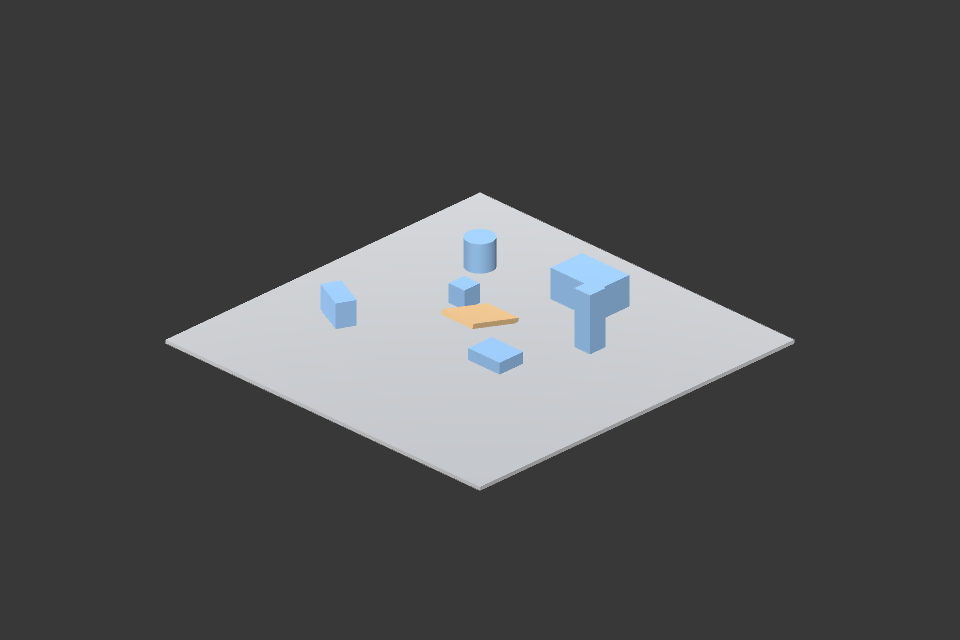

# Tanuki Map Authoring

A Unity authoring kit for portable Tanuki maps. Create scenes in Unity, place
markers, validate the supported content, and export one `.tanukimap` file for
the Unreal runtime prototype. No Unreal Editor is needed for authoring.

**Prototype / prerelease.** This package exports static scenery, collision and
player starts, with a direct Workshop publishing frontend. Map scripting is not implemented, and
this is not yet an OpenUPM release.

The working preview.9 source writes playable-map manifest version 2, including
the required boundary. It needs an updated Tanuki runtime; older runtimes reject
it instead of silently dropping the barrier. Legacy version-1 files remain editable.
The updated Unreal map editor and gameplay runtime retain the boundary as well. The public preview.7 Git pin below
is the previous release, not these unpublished UX changes.



## Install with Unity Package Manager

Open **Window > Package Manager**, choose **Add package from Git URL**, and paste:

```text
https://github.com/Radbot-Productions/TanukiMapAuthoring.git#v0.1.0-preview.7
```

Git must be installed and available to Unity. The declared minimum is Unity
2021.3. Validated editors include Unity 2023.1.0b18 and Unity 6.6
**6000.6.7f1** (Windows). Unity 6 checks cover Git Package Manager installation,
authoring commands, editable import/export, metadata and collision round trips,
and rendered previews in Built-in and URP 17.6.0. Newer patches need fresh validation.
Built-in and URP/Lit materials are supported within the
subset below. For local development, choose **Add package from disk** and select
`package.json`.

## Author a map

Use **Tanuki > Map Editor > New > Create Empty Map** for a plain floor, or
**Start From Sample** for Room/Courtyard. Both include four player starts, a
boundary, lighting and the Player Character automatically. Press Unity's Play
button immediately to test the map. Opened files and Workshop maps receive the
same local preview setup. The preview player and camera are excluded from exports.

### Open and extend an existing map

Use **Tanuki > Map Editor > Open > Steam Workshop** to choose a subscribed map, or
**Map Editor > Open > Map File**. Import creates a new asset folder
and scene containing durable meshes, textures, materials, collision and
player starts. New/Open replaces the current scene without asking to save it;
unsaved scene edits are discarded. Existing imported assets are never overwritten.

Your own Workshop map keeps its identity and publishing association. Another
creator's map automatically becomes a new map when opened. An ID lookup is
available under **Open by Workshop ID**. Publishing uses the logged-in Steam client
and still requires developer access while Tanuki's Workshop is restricted.

New exports include optional names, hierarchy, local transforms and collider
settings. Older files reconstruct from their baked runtime data. Original Unity
prefab links, scripts and arbitrary editor components cannot be recovered from a
runtime map. Across Unreal/Unity, primitive colliders and starts may be flattened
to preserve their runtime placement under nonuniformly scaled hierarchies.

The samples are deliberately small blockouts made from ordinary primitives and
flat colors. Room has a floor, three walls, three blocks and a ramp. Courtyard
has a floor, scattered blocks, a cylinder, a low platform and a ramp. Each has
one boundary and four starts. There are no decorative buildings, foliage or textures.
New templates live under `Assets/TanukiBlockoutSamplesV2`; existing scenes are preserved.

### Create a new map

1. Open **Tanuki > Map Editor > New**.
2. Choose **Create Empty Map**, or **Start From Sample** and select Courtyard or
   Room. Starting from a sample creates a new scene and identity.
3. Author geometry under the map root. Keep its world scale at one; its local
   frame is the export origin. Child mesh transforms are baked.
4. Add Unity colliders to blocking surfaces. Visible geometry does not imply collision.
5. Use **Tanuki > Components > Player Start** to place at least four starts. Position
   its center above the floor and rotate its cyan forward arrow.
6. Keep the same **Map ID** for revisions. New map roots get unique IDs.
7. Every new root includes one Map Boundary. Select it to choose Box or Cylinder;
   use Unity's Transform tools to position, rotate and resize it. A cylinder needs
   equal X/Z scale. Its transparent preview is not exported as scenery.
8. Choose **Map Editor > Export**, then **Steam Workshop** or **Map File**.
   Both validate the current scene automatically. Export requires static geometry,
   exactly one active boundary and at least four active Player Starts.

The map root Inspector owns the map name, stable ID, optional preview image and
export shortcuts. The dialogs report errors and support corrected retries.
Components support Undo and are also available
under **GameObject > Tanuki** and **Add Component > Tanuki**.

## Export directly to Steam Workshop

**Tanuki > Export Map > Steam Workshop** publishes the current
scene without a separate manual file export. Windows is supported by this prototype.

1. Run Steam, signed into a developer account authorized for Tanuki.
2. The panel displays the connected Steam account. Use **Connect** to reconnect
   after starting Steam or signing in. Publishing does not require the game executable.
3. The title defaults to the map name. Leave **Preview PNG** empty to generate a framed map overview,
   or choose your own PNG smaller than 1 MiB. The generated view uses the Scene
   view's orientation and fits all map geometry; other scene objects/scripts are excluded.
4. Choose **Publish** for a new map or **Update Workshop** for your existing map.
   The panel exports a fresh `.tanukimap` and publishes directly through the running
   Steam client, showing pending state and the final result. Credentials stay in Steam.
5. The item ID is assigned automatically and remembered on the map root and in
   reload-recovery state. Save the Unity scene to retain its publishing association.
   A failed/uncertain submission can still have created an item; retain its ID and
   inspect the job log before creating another item.

The package includes editor-only Steamworks.NET bindings and the matching Windows
Steam API redistributable. It initializes the Tanuki app context and uses the logged-in
account. No game process, password prompt or developer credential is used. These
dependencies are excluded from player builds. See `Editor/SteamworksNET/PROVENANCE.md`.

Uploads survive Unity script reloads, retaining their SDK call and item IDs. Closing
Unity or entering Play mode during an upload reports an uncertain outcome and keeps
the recorded item ID for recovery. Files/receipts remain under `Library/TanukiWorkshop`;
only `content/map.tanukimap` is sent as Workshop content. The preview and diagnostics
remain outside the content directory. Do not delete pending job files.

Use a dedicated map-authoring project if another Steam integration is already loaded:
the plugin refuses to take over that integration's Steam context. Supported publishing
is Windows Editor in Edit mode; local file export remains usable without Steam.

Tanuki's Workshop remains **Only Developers** during testing. Item visibility is
shared within that restricted Workshop. The uploader does not change the hub's
access settings or accept Steam legal agreements. If Steam requests agreement
acceptance, complete it yourself in Steam, then update the recorded item ID.

## Supported content

The courtyard is a small outdoor sample with four exterior shops, shoji-style
windows, terracotta roofs, faceted trees, a gate, planters, benches, crates,
lanterns and four player starts. Its meshes and materials are generated locally;
no asset-store downloads are required. Shops are static exterior structures.
The Unity preview camera and light are outside the export root; their lighting
does not transfer to Tanuki. Give the sample a new Map ID when using it as the
starting point for a different map.

Share/load the saved `.tanukimap` file. It contains the JSON manifest and GLB,
including geometry, PNG textures, collision and player starts. There are no
required sidecar files or folders, Unity assets, AssetBundles or C# assemblies.
The batch diagnostics API can explicitly write loose JSON/GLB inspection copies;
normal authoring exports do not.

- Static readable triangle meshes, including nested, scaled and mirrored mesh transforms.
- Standard/URP Lit base-color textures, scalar metallic/smoothness, opaque/cutout materials.
- Box, sphere, capsule and static non-convex MeshCollider collision.
- PlayerStart position, facing and optional spawn tag.
- Up to 10,000 entries per category and a 256 MiB GLB payload.

Unsupported shaders/material features, extra layered materials, trigger/convex
colliders, sheared primitive colliders, LOD groups, Terrain, skinned meshes and
rigidbodies produce errors. Select/bake one LOD and convert Terrain to meshes.
Normal/metallic textures, emission, translucency and texture tiling/offset are
not supported yet. Mesh Read/Write must be enabled; texture Read/Write is not required.

Unity scripts, animation, lighting and game logic do not transfer. PlayerStart
markers select native or configured cooked classes in the game; they do not
generate Unreal Blueprint assets.

## Format

The `.tanukimap` container has a 16-byte little-endian header: four-byte `TMAP`
magic, uint32 version `1`, UTF-8 manifest length, and GLB length. Those two
payloads follow. The manifest records a SHA-1 geometry digest for accidental
mismatch detection, not authentication.

Manifest schema `1` contains `mapId`, `sceneSha1`, `meshes`, `colliders` and
`markers`. GLB vertices are baked relative to the root. Manifest transforms are
Unreal centimetres: `(X,Y,Z) = 100 * Unity (Z,X,Y)`; quaternion components are
`(Unity Z, Unity X, Unity Y, Unity W)`.

## Distribution roadmap

Git installation is the prototype path. OpenUPM submission is planned for
release. Steam Workshop will distribute exported maps separately from this
package. Unreal and Godot authoring frontends will target the same map contract.

## License

MIT. See [LICENSE.md](LICENSE.md). This repository contains only the Unity
kit; it does not include Tanuki game source, game assets or the Unreal runtime.
Steamworks.NET source retains its MIT notice; the Steam API DLL is Valve's
redistributable and is not relicensed as Tanuki code.

### Preview movement

Choose **Tanuki > Materials > PBR / Cutout / Transparent** to create an editable
sample copy in the selected Project folder. Shader definitions and sample materials
live in the plugin under `Shaders` and `Runtime/Materials`. Use Unity's normal
Material Inspector: the shader is **Tanuki/PBR**, **Tanuki/Cutout**, or
**Tanuki/Transparent**, with only portable inputs. PBR includes optional emission.
Roughness is exposed directly; metallic/roughness maps use green for roughness and
blue for metallic, multiplied by their scalar factors. Disable sRGB for those maps
and AO, and import normal images as Normal Map. Colors/scalars work without maps.
No separate material window or preview rebuild is required.

The tested editor is Unity **6000.6.7f1**. Built-in rendering uses the core package.
URP projects also install `Integrations~/URP/package.json` as a package from disk;
its **Tanuki Materials for URP** shaders remain inside that plugin, rather than
being generated in project Assets. Legacy Standard/URP Lit materials still export;
**Tanuki > Materials > Use Tanuki Shaders on Selected Map** converts their supported
inputs to the dedicated shaders.

New/Open adds a separate **Player Character** object. Select Third Person or
Free Camera in its Inspector, or press F during Play. WASD moves; Space jumps (hold to glide);
Shift runs or releases climbing. Free Camera uses Q/E vertically and Shift to
fly faster. Hold right mouse to capture the cursor; Escape releases it.

The upright proxy uses the basic Tanuki capsule (42 cm wide, 60 cm tall).
Its normal Tanuki speed profile is 2.7 m/s, or 4.5 m/s with Shift, with
acceleration and reduced air control. A 7 m/s jump impulse and 9.8 m/s² gravity
give about 2.5 m of jump height. Hold Space airborne for 0.2 seconds to glide
when at least 1 m above ground; release to resume falling. Glide approaches
1.5 m/s descent with up to 10 m/s steering. The profile follows authored OWL
defaults, GAS attributes and the normal Tanuki role multiplier; it does not
simulate role changes or temporary gameplay effects.
Static-map climbing supports attachment, idle retention, tangent movement,
corner following and top-out. It approximates object-form movement, without
wall jumps or sculpted-body collision. Use Unreal for final traversal checks.
The helper and all descendants are excluded from exports and thumbnails.
Unity's Input Manager must be enabled (Legacy or Both).

For actual game behavior, use **Play in Tanuki** in the map editor window.
**Choose Tanuki Preview** selects `TanukiMapPreview.exe` from the shared Windows
gameplay package. It exports a temporary snapshot and launches the production
Tanuki pawn, movement, climbing, gliding and camera. The Unity-native helper
described above remains an approximate local blockout tool.

Escape opens Resume, Free Camera / Tanuki Movement, Restart at Spawn, Settings
and Exit Preview. Free camera uses WASD, Q/E, mouse look and Shift for speed.
Closing the player removes its temporary map snapshot. No Unreal editor install
is required. The same gameplay package is used by Blender, Godot and Unreal.
