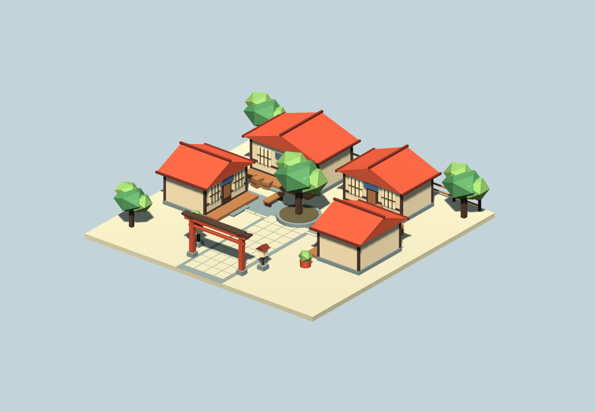

# Tanuki Map Authoring

A Unity authoring kit for portable Tanuki maps. Create scenes in Unity, place
markers, validate the supported content, and export one `.tanukimap` file for
the Unreal runtime prototype. No Unreal Editor is needed for authoring.

**Prototype / prerelease.** This package exports static scenery, collision and
player starts, with a direct Workshop publishing frontend. Map scripting is not implemented, and
this is not yet an OpenUPM release.



## Install with Unity Package Manager

Open **Window > Package Manager**, choose **Add package from Git URL**, and paste:

```text
https://github.com/Radbot-Productions/TanukiMapAuthoring.git#v0.1.0-preview.7
```

Git must be installed and available to Unity. The declared minimum is Unity
2021.3. Validated editors include Unity 2023.1.0b18 and Unity 6.6
**6000.6.7f1** (Windows). Unity 6 checks cover Git Package Manager installation,
authoring commands, editable import/export, metadata and collision round trips,
and rendered previews in Built-in and URP 17.6.0. Newer patches need fresh validation.
Built-in and URP/Lit materials are supported within the
subset below. For local development, choose **Add package from disk** and select
`package.json`.

## Author a map

### Open and extend an existing map

Use **Open .tanukimap** in **Tanuki > Map Authoring**, or refresh the subscribed
Workshop list and choose **Download & Open**. Import creates a new asset folder
and additive scene containing durable meshes, textures, materials, collision and
player starts. Save any untitled scene first. Existing imported assets are never
overwritten.

**Fork** creates a new map identity and a new Workshop item on upload. Turn Fork
off to continue your own item; its item ID is remembered for subsequent updates.
Another author's item must be forked. Publishing uses the logged-in Steam client
and still requires developer access while Tanuki's Workshop is restricted.

New exports include optional names, hierarchy, local transforms and collider
settings. Older files reconstruct from their baked runtime data. Original Unity
prefab links, scripts and arbitrary editor components cannot be recovered from a
runtime map. Across Unreal/Unity, primitive colliders and starts may be flattened
to preserve their runtime placement under nonuniformly scaled hierarchies.

### Create a new map

1. Open **Tanuki > Map Authoring**.
2. Choose **Open Sample Map**, or **Create Map Root**. The sample generator creates
   a stylized courtyard, materials, meshes, preview lighting/camera and four
   player starts in `Assets/TanukiCourtyard`. It opens an existing courtyard
   without replacing it. The original basic room/prefab generator remains at
   **Tanuki > Create Sample Map** for regression work.
3. Author geometry under the map root. Keep its world scale at one; its local
   frame is the export origin. Child mesh transforms are baked.
4. Add Unity colliders to blocking surfaces. Visible geometry does not imply
   collision. **Add Box Collider** works on a selected map object without one.
5. Choose **Add Player Start**, or place the sample PlayerStart prefab. Position
   its center above the floor and rotate its cyan forward arrow.
6. Keep the same **Map ID** for revisions. New map roots get unique IDs.
7. Choose **Validate Map**. This performs the same complete conversion as export,
   including texture readback, without writing export files.
8. Choose **Export .tanukimap**, pick a filename and save. Export validates the
   current scene again and writes exactly one file. **Show Exported File** reveals it.

The panel reports errors and supports corrected retries. Root/player-start
creation and collider additions support Undo. Components are also available
under **GameObject > Tanuki** and **Add Component > Tanuki**.

## Export directly to Steam Workshop

The **Steam Workshop** section in **Tanuki > Map Authoring** publishes the current
scene without a separate manual file export. Windows is supported by this prototype.

1. Run Steam, signed into a developer account authorized for Tanuki.
2. The panel displays the connected Steam account. Use **Connect Steam** to reconnect
   after starting Steam or signing in. Publishing does not require the game executable.
3. Enter a title. Leave **Preview PNG** empty to generate a framed map overview,
   or choose your own PNG smaller than 1 MiB. The generated view uses the Scene
   view's orientation and fits all map geometry; other scene objects/scripts are excluded.
4. Leave **Item ID** empty to create a map, then choose **Export & Upload to Workshop**.
   The panel exports a fresh `.tanukimap` and publishes directly through the running
   Steam client, showing pending state and the final result. Credentials stay in Steam.
5. The returned item ID is remembered per Unity project and Map ID. Choose
   **Use Last Uploaded Item** and **Export & Update Workshop Item** for revisions.
   A failed/uncertain submission can still have created an item; retain its ID and
   inspect the job log before creating another item.

The package includes editor-only Steamworks.NET bindings and the matching Windows
Steam API redistributable. It initializes the Tanuki app context and uses the logged-in
account. No game process, password prompt or developer credential is used. These
dependencies are excluded from player builds. See `Editor/SteamworksNET/PROVENANCE.md`.

Uploads survive Unity script reloads, retaining their SDK call and item IDs. Closing
Unity or entering Play mode during an upload reports an uncertain outcome and keeps
the recorded item ID for recovery. Files/receipts remain under `Library/TanukiWorkshop`;
only `content/map.tanukimap` is sent as Workshop content. The preview and diagnostics
remain outside the content directory. Do not delete pending job files.

Use a dedicated map-authoring project if another Steam integration is already loaded:
the plugin refuses to take over that integration's Steam context. Supported publishing
is Windows Editor in Edit mode; local file export remains usable without Steam.

Tanuki's Workshop remains **Only Developers** during testing. Item visibility is
shared within that restricted Workshop. The uploader does not change the hub's
access settings or accept Steam legal agreements. If Steam requests agreement
acceptance, complete it yourself in Steam, then update the recorded item ID.

## Supported content

The courtyard is a small outdoor sample with four exterior shops, shoji-style
windows, terracotta roofs, faceted trees, a gate, planters, benches, crates,
lanterns and four player starts. Its meshes and materials are generated locally;
no asset-store downloads are required. Shops are static exterior structures.
The Unity preview camera and light are outside the export root; their lighting
does not transfer to Tanuki. Give the sample a new Map ID when using it as the
starting point for a different map.

Share/load the saved `.tanukimap` file. It contains the JSON manifest and GLB,
including geometry, PNG textures, collision and player starts. There are no
required sidecar files or folders, Unity assets, AssetBundles or C# assemblies.
The batch diagnostics API can explicitly write loose JSON/GLB inspection copies;
normal authoring exports do not.

- Static readable triangle meshes, including nested, scaled and mirrored mesh transforms.
- Standard/URP Lit base-color textures, scalar metallic/smoothness, opaque/cutout materials.
- Box, sphere, capsule and static non-convex MeshCollider collision.
- PlayerStart position, facing and optional spawn tag.
- Up to 10,000 entries per category and a 256 MiB GLB payload.

Unsupported shaders/material features, extra layered materials, trigger/convex
colliders, sheared primitive colliders, LOD groups, Terrain, skinned meshes and
rigidbodies produce errors. Select/bake one LOD and convert Terrain to meshes.
Normal/metallic textures, emission, translucency and texture tiling/offset are
not supported yet. Mesh Read/Write must be enabled; texture Read/Write is not required.

Unity scripts, animation, lighting and game logic do not transfer. PlayerStart
markers select native or configured cooked classes in the game; they do not
generate Unreal Blueprint assets.

## Format

The `.tanukimap` container has a 16-byte little-endian header: four-byte `TMAP`
magic, uint32 version `1`, UTF-8 manifest length, and GLB length. Those two
payloads follow. The manifest records a SHA-1 geometry digest for accidental
mismatch detection, not authentication.

Manifest schema `1` contains `mapId`, `sceneSha1`, `meshes`, `colliders` and
`markers`. GLB vertices are baked relative to the root. Manifest transforms are
Unreal centimetres: `(X,Y,Z) = 100 * Unity (Z,X,Y)`; quaternion components are
`(Unity Z, Unity X, Unity Y, Unity W)`.

## Distribution roadmap

Git installation is the prototype path. OpenUPM submission is planned for
release. Steam Workshop will distribute exported maps separately from this
package. Unreal and Godot authoring frontends will target the same map contract.

## License

MIT. See [LICENSE.md](LICENSE.md). This repository contains only the Unity
kit; it does not include Tanuki game source, game assets or the Unreal runtime.
Steamworks.NET source retains its MIT notice; the Steam API DLL is Valve's
redistributable and is not relicensed as Tanuki code.
